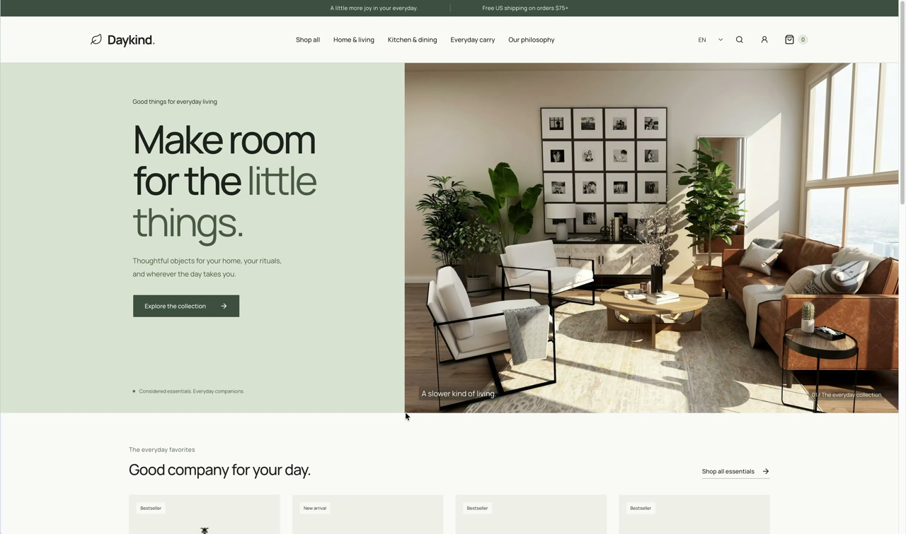

# Daykind

项目目录与 npm 包名：`daykind-demo`。

面向海外消费者的中英文生活方式商品选购 Demo。包含 30 件固定商品、响应式浏览与筛选、游客购物车、真实注册登录、云端购物车、模拟结账和订单快照。

线上演示：[https://daykind-demo.onrender.com](https://daykind-demo.onrender.com)。已完成内容、验证范围、已知问题及主要取舍见[项目总结](docs/project-summary.md)。

技术栈：React / TypeScript / Vite、TanStack Router / Query / Form、Tailwind CSS / shadcn/ui、i18next / react-i18next、Zod、MSW、Supabase Auth / Postgres / Edge Functions。支付流程使用模拟支付。

## 演示视频

演示商品浏览与筛选、购物车、登录、模拟结账与订单，以及移动端布局，时长约 1 分 45 秒。

[](docs/media/daykind-demo.mp4)

[观看或下载演示视频（MP4）](docs/media/daykind-demo.mp4)

## 本地启动

需要 Node.js 24.18+、pnpm 12.11.2 和正在运行的 Docker Desktop。首次启动 Supabase 会下载 Docker 镜像，需联网；之后商品展示不依赖第三方商品或图片 API。

```bash
corepack enable
pnpm install --frozen-lockfile
pnpm backend:start
pnpm local:env
```

`local:env` 自动生成不入库的 `.env.local` 和 `.env.test.local`，不会把服务端密钥写进浏览器配置。数据库 migrations 会在首次启动时自动执行。

分别在两个终端启动函数和前端：

```bash
pnpm backend:serve
```

```bash
pnpm dev
```

打开 http://localhost:3000。无需 Supabase 云端账号。注册任意测试邮箱及至少 8 位密码即可直接登录，Confirm email 已在本地配置中关闭。

停止本地数据库：`pnpm backend:stop`（保留 Docker 数据卷）。关闭前端/函数终端用 Ctrl+C。修改 migration 后使用 `pnpm exec supabase db reset` 会重建本地数据库并删除本地演示账号和订单，仅在确认不需保留数据时执行。

## 演示路径

1. 首页或商品列表选商品；列表支持搜索、分类、价格、排序和分页，条件保存在 URL。
2. 在详情页选颜色和数量，加入购物车；游客购物车保存于 localStorage。
3. 购物车进入结账，创建账号；同 SKU 游客/云端数量取较大值，只有云端合并成功才清理游客购物车。
4. 填入美国地址，例如 `125 Market Street / San Francisco / CA / 94103`。
5. 选择 Successful payment 或 Declined payment。成功清理本次购买商品；失败保留购物车，可开始新尝试。
6. 订单详情和列表在刷新、重新登录后仍可读取。支付均明确标注 Mock，不收集银行卡信息。

运费为 $6.99，商品小计满 $75 免费，税额为演示值 $0。所有金额使用整数分。

## 中英文切换

页面右上角的 `EN / 中文` 下拉框支持即时切换，默认英文。语言选择存储在 localStorage 的 `ee-language` 中，刷新后仍会保留；存储不可用时仍能在当前页面切换。

导航、商品名称与描述、规格、筛选、购物袋、表单校验、结账及订单状态均已接入翻译。搜索同时匹配中英文商品名称和描述，名称排序按当前语言进行。切换语言保留当前 URL 筛选、购物袋及表单输入。

金额和订单日期按语言格式化，计价币种始终为 USD，收货国家仍为美国。商品 ID、SKU 和订单成交快照保持原始值；订单展示时翻译已知名称，未知的历史名称保留原文。无需修改数据库或环境变量。

界面中文词条位于 `src/locales/zh.ts`，以英文原文为翻译键；商品中文内容位于 `src/locales/catalog.ts`，按稳定商品 ID 维护。英文与中文资源随应用打包，不请求远程翻译服务。入口配置为 `src/lib/i18n.ts`。

## 检查与测试

```bash
pnpm typecheck
pnpm lint
pnpm test
pnpm build
pnpm test:integration
pnpm exec playwright install chromium
pnpm test:e2e
```

集成测试和端到端测试需要本地 Supabase、checkout 函数，以及 `pnpm local:env` 生成的测试环境。Playwright 会复用已运行的前端，或自动启动 Vite。测试创建独立账号并在结束后删除，不使用个人云端项目。

- 单元测试：整数金额、免邮边界、SKU、库存/数量限制、购物车合并、地址校验。
- 后端集成：真实注册、RLS 隔离、未登录拒绝、客户端禁止写订单、原子合并、购物车版本冲突、失败支付、并发幂等、事务回滚、保留后来加入的商品、服务端重新定价。
- 浏览器：完整桌面/手机购物、订单刷新、失败后重试、丢失响应后恢复、登录错误与换账号、合并失败恢复、375/768/1440 布局、可访问性检查。

[本地验收记录](docs/verification.md) 已记录实际通过结果。测试报告位于忽略的 `playwright-report/`，可用 `pnpm exec playwright show-report` 查看。

## Mock 边界

MSW 只拦截 `/api/catalog/products`、`/api/catalog/products/:id` 和 `/api/catalog/categories`。前端等待 worker 启动后才渲染。线上 Demo 也启用商品 Mock。账号、购物车、订单和结账始终请求真实 Supabase，不在失败时用假成功替代。

固定目录在 `supabase/functions/_shared/catalog.ts`，浏览器与 Edge Function 共用；商品图片和字体在本地包内。商品数据不写入数据库，订单明细保存成交快照。修改目录后需同时重新构建前端和部署函数。

可在浏览器开发工具中切换商品场景，然后刷新：

```js
localStorage.setItem('ee-catalog-scenario', 'error') // 错误 + 重试
localStorage.setItem('ee-catalog-scenario', 'empty') // 空结果
localStorage.removeItem('ee-catalog-scenario') // 恢复
```

直接请求 `/api/catalog/products?scenario=slow` 可模拟延迟；`scenario=error|empty` 同样可用。生产浏览器中禁止使用真实服务端密钥。

## 数据与结账

仅三张业务表：`cart_items`、`orders`、`order_items`，全部启用 RLS。用户可管理自己的购物车并读取自己的订单；订单写入只允许 Edge Function 内部调用 `commit_checkout`。

Edge Function 验证访问令牌，校验商品 SKU / 数量 / 固定库存，重新计算价格。事务锁定所购购物车行并核对 `updated_at` / 数量，原子生成订单和明细；成功只移除购买快照中的行。新加入的其他 SKU 不会被清理。

幂等键按用户唯一，并绑定请求摘要。并发或网络重试返回同一订单，修改请求复用键会被拒绝。浏览器在 sessionStorage 保存完整待确认尝试，响应丢失后即使刷新、购物车已清空，也可 Recover checkout attempt 查询原订单。明确失败的支付订单开始新的尝试。

源码位置：

- `src/routes/`：自动生成路由树对应的业务页面（不手写 `routeTree.gen.ts`）。
- `src/lib/`：Query、认证、购物车、结账和类型。
- `src/mocks/`：商品 MSW handlers。
- `src/components/ui/`：shadcn CLI 生成的 Radix 组件。
- `supabase/migrations/`：表、约束、RLS、原子合并和结账事务。
- `supabase/functions/checkout/`：真实身份认证和模拟支付入口。
- `tests/`：单测、真实后端集成、浏览器测试。

## 线上部署

当前已使用 Supabase + Render 静态站点部署，线上业务流程由项目负责人手动验证通过。部署和后续更新步骤见[部署说明](docs/deployment.md)，实际验证范围见[项目总结](docs/project-summary.md)。免费额度以实际账号当时的政策为准。

本版本不含真实支付、库存扣减、后台管理、汇率、优惠券、邮件通知或找回密码。

[视觉规范](docs/design.md) · [素材来源](docs/assets.md) · [初始化与文档记录](docs/implementation.md)
